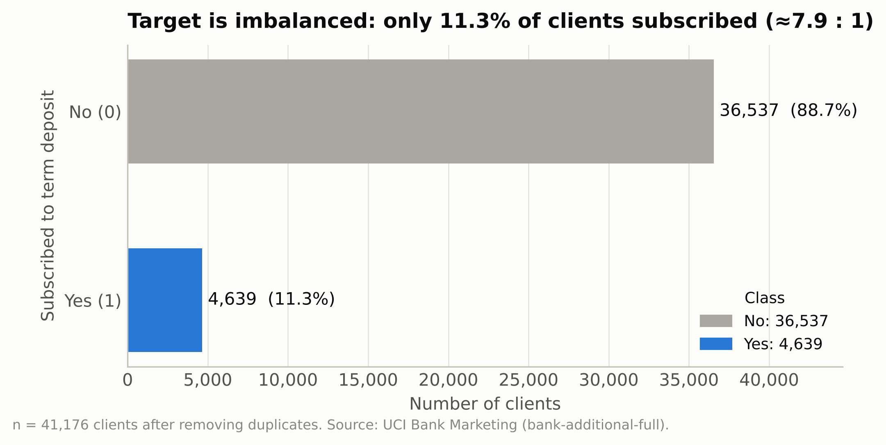
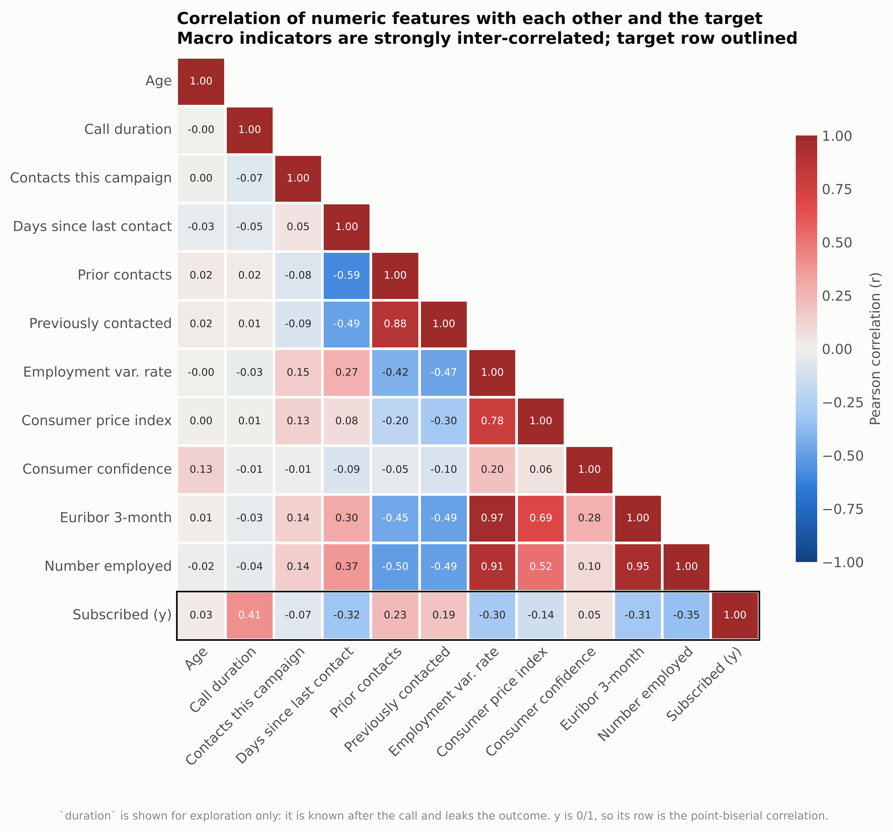
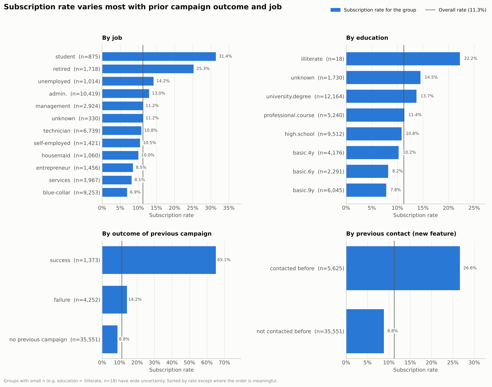
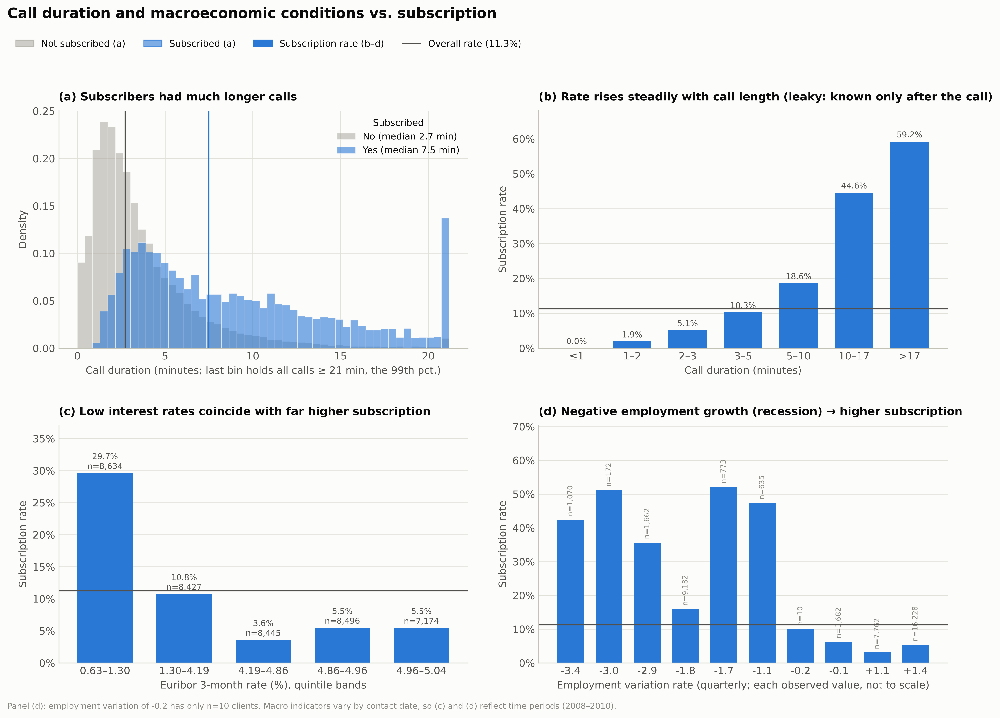
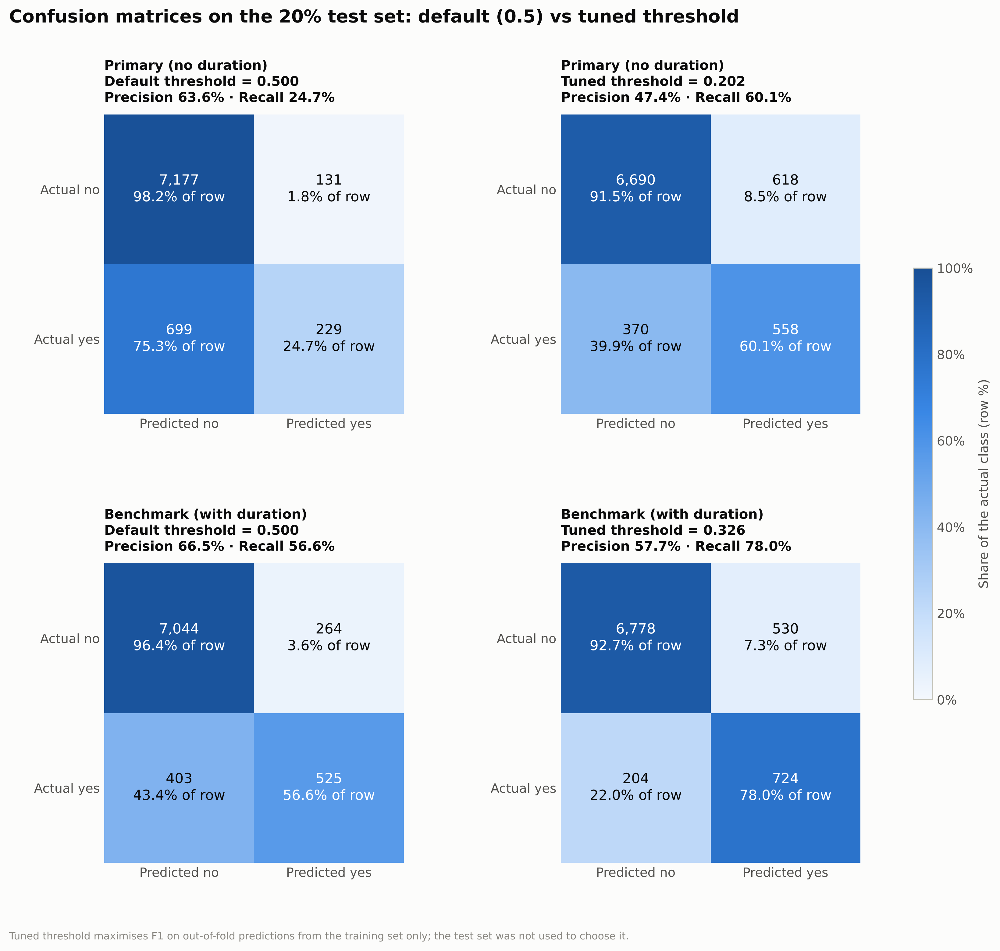
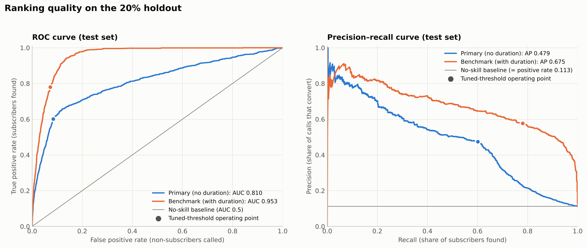
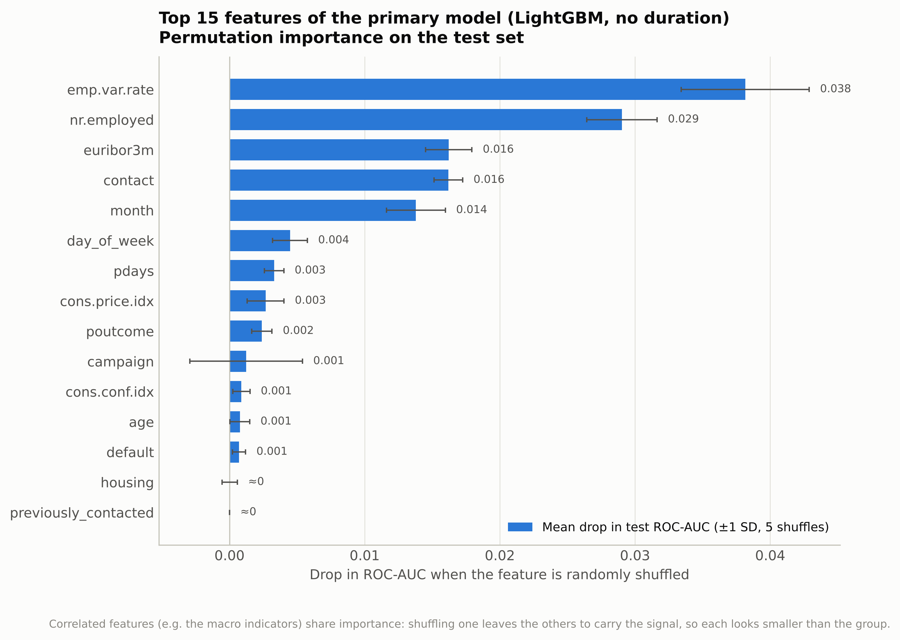
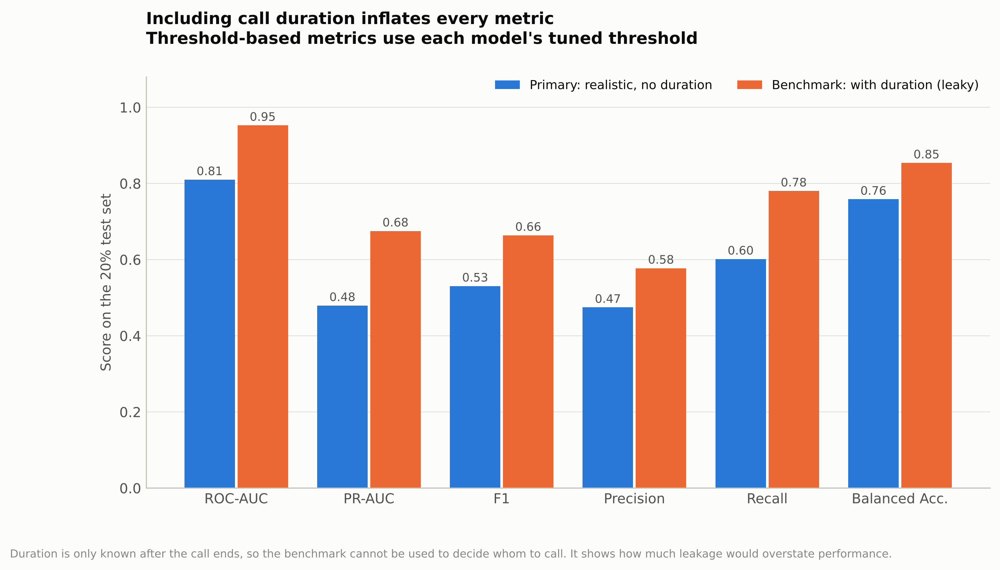

# Predicting Term Deposit Subscriptions with AutoML

**Course:** DTO 5389 – Digital Transformation Technologies · **Assignment 2**
**Student Name:** [Student Name] · **Student Number:** [Student Number] · **Date:** [Date]
**Dataset:** UCI Bank Marketing, `bank-additional-full.csv` (Moro et al., 2014)
**Tools:** Python 3.13, pandas, scikit-learn (Pedregosa et al., 2011), FLAML 2.7, LightGBM, XGBoost

---

## 1. Executive Summary and Objective

A Portuguese bank ran telephone campaigns (May 2008 – November 2010) to sell term deposits, and only
**11.3% of contacted clients subscribed** (Moro et al., 2014). The objective is a classifier that
ranks clients by subscription probability **before they are called**, so the call centre can focus
its capacity. The 11.3% imbalance was addressed with stratified splits, ROC-AUC optimisation, PR-AUC
reporting and decision-threshold tuning.

FLAML (Wang et al., 2021) selected a **LightGBM** model with a test **ROC-AUC of 0.810** and
**PR-AUC of 0.479** (4.3× the 0.113 baseline). Calling the top-scored **20% of clients reaches 67% of
all subscribers**, a 3.4× lift over random calling. A benchmark that also used call `duration`
scored ROC-AUC 0.953, but duration is only known after a call ends; the 0.143 gap measures how much
leakage would overstate performance.

## 2. Environment, Data Import and Cleaning

The project uses a virtual environment with pinned dependencies, a verification script
(`scripts/verify_env.py`), and three scripts that regenerate every result
(`src/data_preprocessing.py`, `src/eda_visualization.py`, `src/train_and_evaluate.py`). The
semicolon-delimited file loaded with the documented **41,188 rows × 21 columns**, the expected
column names and types, and no `NaN` values.

| Issue | Finding | Treatment |
|---|---|---|
| Exact duplicates | 12 rows | Removed → **41,176 rows** (prevents train/test leakage) |
| `unknown` values | 6 columns; 26.0% of rows | Kept as an informative category |
| Outliers (IQR rule) | Age > 69.5, campaign > 6, long calls | Kept: plausible values; trees are scale-robust |
| `pdays = 999` sentinel | 96.3% of rows (real values 0–27) | Kept raw; added `previously_contacted` |

`unknown` is informative rather than random: clients with `default = unknown` subscribe at 5.2%
versus 12.9% for `no`, a signal imputation would erase. Cleaning also revealed **4,110 clients**
with `pdays = 999` ("never contacted") but `previous > 0`, so the engineered flag uses both columns:

```python
df = pd.read_csv("data/raw/bank-additional-full.csv", sep=";")       # 41,188 x 21
df = df.drop_duplicates(keep="first").reset_index(drop=True)         # -12 rows
df["previously_contacted"] = ((df["pdays"] != 999) | (df["previous"] > 0)).astype(int)
df["y"] = df["y"].map({"no": 0, "yes": 1})
```

## 3. Exploratory Data Analysis and Feature Insights



*Figure 1. Class balance: 4,639 subscribers out of 41,176 (11.3%).*

Predicting "no" for everyone already scores 88.7% accuracy (Figure 1), so accuracy cannot guide
model selection.



*Figure 2. Correlations among numeric features and the target.*

The strongest linear associations with `y` are `duration` (r = +0.41), `nr.employed` (−0.35) and
`euribor3m` (−0.31) (Figure 2). The macroeconomic indicators are highly collinear
(`emp.var.rate`–`euribor3m` r = 0.97; `euribor3m`–`nr.employed` 0.95), which destabilises linear
coefficients and splits importance across columns but does not harm tree ensembles.



*Figure 3. Subscription rate by job, education, previous outcome and prior contact.*

A previous campaign success lifts conversion to **65.1%**, and any prior contact triples it (26.6%
vs 8.8%). Students (31.4%) and retirees (25.3%) respond most; blue-collar workers (6.9%) least
(Figure 3).



*Figure 4. Call duration vs outcome (a–b); subscription by Euribor and employment variation (c–d).*

Conversion climbs from 0% for calls under a minute to 59% for calls over 17 minutes, a classic
leakage signature. In the lowest Euribor quintile 29.7% subscribed versus 3.6–5.5% in the top three
(Figure 4); because these indicators vary by contact date, they act as time-period effects. **Age is
non-linear**: its correlation is only r = +0.03, yet conversion is U-shaped (24.0% at ≤ 24, 8.6% at
45–54, 47.3% over 65), which favours tree-based learners.

| Numeric feature | ROC-AUC alone | Categorical feature | Cramér's V |
|---|---|---|---|
| `duration` (leaky) | 0.818 | `poutcome` | 0.321 |
| `nr.employed` | 0.749 | `month` | 0.275 |
| `euribor3m` | 0.743 | `job` | 0.153 |
| `emp.var.rate` | 0.717 | `contact` | 0.145 |

`housing`, `loan` and `day_of_week` show almost no association (V ≤ 0.025).

## 4. AutoML Methodology and Pipeline Configuration

**FLAML over PyCaret.** PyCaret's released versions did not support the project's Python 3.13 at
the time of writing; FLAML installed cleanly, is lightweight with a scikit-learn-style API, and its
cost-aware CFO search (Wu et al., 2021) makes a short fixed budget productive.

**Configuration.** ROC-AUC was optimised because it measures *ranking* quality independently of the
threshold and class ratio, matching the "whom to call first" decision; PR-AUC was also reported as
it is more informative under imbalance (Saito & Rehmsmeier, 2015). Candidates were scored with
**5-fold stratified cross-validation** on the 80% training split; the stratified 20% test split
(`random_state = 42`) was never used in the search. The search covered LightGBM (Ke et al., 2017),
XGBoost (Chen & Guestrin, 2016), random forest and logistic regression, with 180 seconds per model.
**`duration` was explicitly excluded** from the primary model; an identical benchmark retaining it
measures the leakage effect (Kaufman et al., 2012).

```python
features = [c for c in df.columns if c not in ("y", "duration")]   # no leakage
automl = AutoML()
automl.add_learner("lr", ScaledLogisticRegression)                  # custom learner
automl.fit(X_train[features], y_train, task="classification", metric="roc_auc",
           eval_method="cv", n_splits=5, split_type="stratified",
           estimator_list=["lgbm", "xgboost", "rf", "lr"], time_budget=180, seed=42)
```

FLAML's built-in logistic regression integer-codes categories without scaling, an unfair linear
baseline, so a custom learner wraps one-hot encoding and standardisation:

```python
class ScaledLogisticRegression(SKLearnEstimator):
    @classmethod
    def search_space(cls, data_size, task, **params):
        return {"C": {"domain": tune.loguniform(1e-3, 1e3), "init_value": 1.0}}
    def __init__(self, task="binary", **config):
        super().__init__(task, **config)
        self.estimator_class = OneHotLogisticRegression  # one-hot + scaling + LR
```

Because probabilities rarely exceed 0.5 at an 11% base rate, the F1-maximising threshold (**0.202**)
was chosen from out-of-fold predictions on the training set, keeping the test set untouched.

## 5. Model Evaluation and Comparison

FLAML selected **LightGBM** (CV ROC-AUC 0.802): 1,240 shallow trees (`num_leaves` = 4), learning
rate 0.098 and strong L2 regularisation (`reg_lambda` = 38.4). The duration benchmark selected
**XGBoost** (CV ROC-AUC 0.949). Test results (8,236 clients, 928 subscribers):

| Model | Threshold | Accuracy | Bal. Acc. | Precision | Recall | F1 | ROC-AUC | PR-AUC |
|---|---|---|---|---|---|---|---|---|
| Primary LightGBM | 0.5 | 0.899 | 0.614 | 0.636 | 0.247 | 0.356 | **0.810** | **0.479** |
| Primary LightGBM | **0.202** | 0.880 | 0.758 | 0.474 | 0.601 | **0.530** | 0.810 | 0.479 |
| Benchmark XGBoost (+duration) | 0.5 | 0.919 | 0.765 | 0.665 | 0.566 | 0.612 | 0.953 | 0.675 |
| Benchmark XGBoost (+duration) | 0.326 | 0.911 | 0.854 | 0.577 | 0.780 | 0.664 | 0.953 | 0.675 |

Test ROC-AUC (0.810) closely matches the CV estimate (0.802), so the search did not overfit.



*Figure 5. Confusion matrices at the default and tuned thresholds.*

At 0.5 the primary model finds only 24.7% of subscribers; at 0.202 it finds **60.1%**, i.e. 329 more
subscribers for 487 extra calls (Figure 5). F1 rises from 0.356 to 0.530 while accuracy *falls*
slightly, again showing why accuracy misleads.



*Figure 6. Test ROC and precision–recall curves with no-skill baselines.*



*Figure 7. Permutation importance (drop in test ROC-AUC) for the primary model.*

The precision–recall curve stays well above the 0.113 baseline at every recall level (Figure 6).
The top drivers are `emp.var.rate`, `nr.employed`, `euribor3m`, `contact` and `month` (Figure 7);
because the macro indicators are collinear, each understates the group's combined importance.



*Figure 8. Realistic primary model vs leaky benchmark.*

Adding `duration` raises ROC-AUC by 0.143 and PR-AUC by 0.196 (Figure 8), and it becomes the
benchmark's most important feature (shuffling it costs 0.226 ROC-AUC). That performance is
unattainable in practice, since call length is unknown when choosing whom to call.

**Business interpretation.** Calling clients in score order:

| Call the top… | Conversion | Subscribers reached | Lift |
|---|---|---|---|
| 10% | 51.3% | 45.6% | 4.6× |
| **20%** | **37.8%** | **67.0%** | **3.4×** |
| 30% | 27.7% | 73.8% | 2.5× |

The top 20% captures two-thirds of subscribers with **80% fewer calls**. Errors are asymmetric: a
false positive costs minutes of agent time, a false negative forfeits a deposit's margin. When
capacity allows, the threshold should sit below 0.202; for instance, if a successful call nets ten
times what an unsuccessful one costs, calling pays off whenever p > 1/11 ≈ 0.09.

## 6. Critical Analysis of AutoML

AutoML automates model selection and hyperparameter optimisation so practitioners can concentrate on
problem formulation (Hutter et al., 2019; He et al., 2021). This project shows both its value and
its limits.

**Strengths.**

1. **Rapid, broad exploration.** In 180 seconds FLAML evaluated 65–101 cross-validated
   configurations across four model families and found a non-obvious optimum (1,240 depth-limited,
   heavily regularised trees). CV and test ROC-AUC agreed (0.802 vs 0.810).
2. **Automated, consistent validation.** Every candidate used the same stratified folds, metric and
   data, eliminating errors such as tuning on the test set, and producing an auditable trial log.
3. **Reduced selection bias.** Algorithm choice followed measured performance rather than analyst
   preference, with compute spent efficiently by the cost-aware search.

**Limitations.**

1. **Blind optimisation without domain awareness.** Given `duration`, FLAML used it immediately and
   reported ROC-AUC 0.953 for a model that cannot be deployed. Detecting leakage required human
   understanding of how the data is generated; AutoML automates search, not problem formulation.
2. **Wall-clock bias between algorithms.** With a time budget, fast learners receive more trials. In
   the final run LightGBM had 41 trials while XGBoost and logistic regression had 2 each; in an
   earlier run XGBoost had 35 and finished within 0.002 of LightGBM. Algorithm rankings from one run
   partly reflect training speed, and slower learners' scores are lower bounds.
3. **Defaults and objectives still need expert review.** Trial counts varied between runs (the
   selected model was stable), the default logistic regression had to be corrected, and FLAML
   optimised ROC-AUC while threshold, error costs and capacity remained manual decisions.

## 7. Limitations and Recommendations for Digital Transformation

The data covers one bank during the 2008–2010 crisis, the evaluation used a random rather than
time-ordered split, and probabilities were not calibrated. Recommendations:

1. **Deploy as a pre-campaign scoring service** in the CRM that produces ranked call lists, with the
   model, feature list and threshold versioned together (`models/model_metadata.json`).
2. **Monitor macroeconomic regime shifts.** Predictions lean on `euribor3m`, `emp.var.rate` and
   `nr.employed`; track input drift (e.g. population stability index) and live conversion, and
   retrain when rates or employment leave the training range.
3. **Tune the threshold to call-centre capacity and economics**, after calibrating probabilities, so
   the call list matches available agents and the cost–margin trade-off.
4. **Validate prospectively and govern responsibly:** pilot model-ranked calling against current
   practice, adopt time-based validation, and review age-based targeting against fair-treatment rules.

## 8. References

Chen, T., & Guestrin, C. (2016). XGBoost: A scalable tree boosting system. In *Proceedings of the
22nd ACM SIGKDD International Conference on Knowledge Discovery and Data Mining* (pp. 785–794).
https://doi.org/10.1145/2939672.2939785

He, X., Zhao, K., & Chu, X. (2021). AutoML: A survey of the state-of-the-art. *Knowledge-Based
Systems, 212*, 106622. https://doi.org/10.1016/j.knosys.2020.106622

Hutter, F., Kotthoff, L., & Vanschoren, J. (Eds.). (2019). *Automated machine learning: Methods,
systems, challenges*. Springer. https://doi.org/10.1007/978-3-030-05318-5

Kaufman, S., Rosset, S., Perlich, C., & Stitelman, O. (2012). Leakage in data mining: Formulation,
detection, and avoidance. *ACM Transactions on Knowledge Discovery from Data, 6*(4), Article 15.
https://doi.org/10.1145/2382577.2382579

Ke, G., Meng, Q., Finley, T., Wang, T., Chen, W., Ma, W., Ye, Q., & Liu, T.-Y. (2017). LightGBM: A
highly efficient gradient boosting decision tree. In *Advances in Neural Information Processing
Systems 30* (pp. 3146–3154).

Moro, S., Cortez, P., & Rita, P. (2014). A data-driven approach to predict the success of bank
telemarketing. *Decision Support Systems, 62*, 22–31. https://doi.org/10.1016/j.dss.2014.03.001

Moro, S., Rita, P., & Cortez, P. (2014). *Bank marketing* [Data set]. UCI Machine Learning
Repository. https://doi.org/10.24432/C5K306

Pedregosa, F., Varoquaux, G., Gramfort, A., Michel, V., Thirion, B., Grisel, O., Blondel, M.,
Prettenhofer, P., Weiss, R., Dubourg, V., Vanderplas, J., Passos, A., Cournapeau, D., Brucher, M.,
Perrot, M., & Duchesnay, É. (2011). Scikit-learn: Machine learning in Python. *Journal of Machine
Learning Research, 12*, 2825–2830.

Saito, T., & Rehmsmeier, M. (2015). The precision-recall plot is more informative than the ROC plot
when evaluating binary classifiers on imbalanced datasets. *PLoS ONE, 10*(3), e0118432.
https://doi.org/10.1371/journal.pone.0118432

Wang, C., Wu, Q., Weimer, M., & Zhu, E. (2021). FLAML: A fast and lightweight AutoML library. In
*Proceedings of Machine Learning and Systems 3* (pp. 434–447).

Wu, Q., Wang, C., & Huang, S. (2021). Frugal optimization for cost-related hyperparameters. In
*Proceedings of the AAAI Conference on Artificial Intelligence, 35*(12), 10347–10354.
https://doi.org/10.1609/aaai.v35i12.17239
